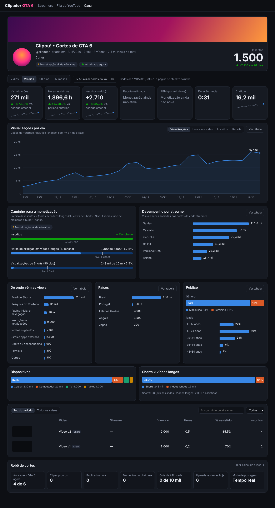
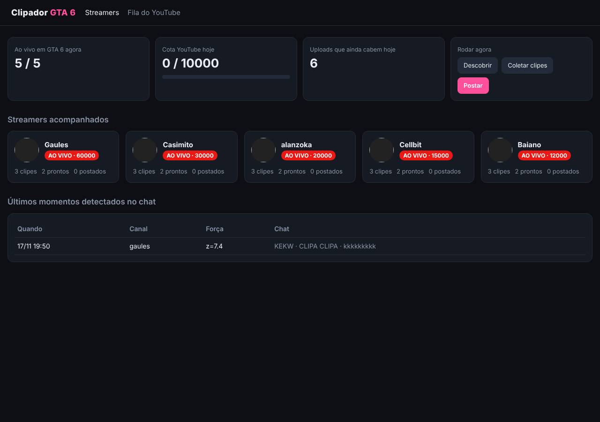
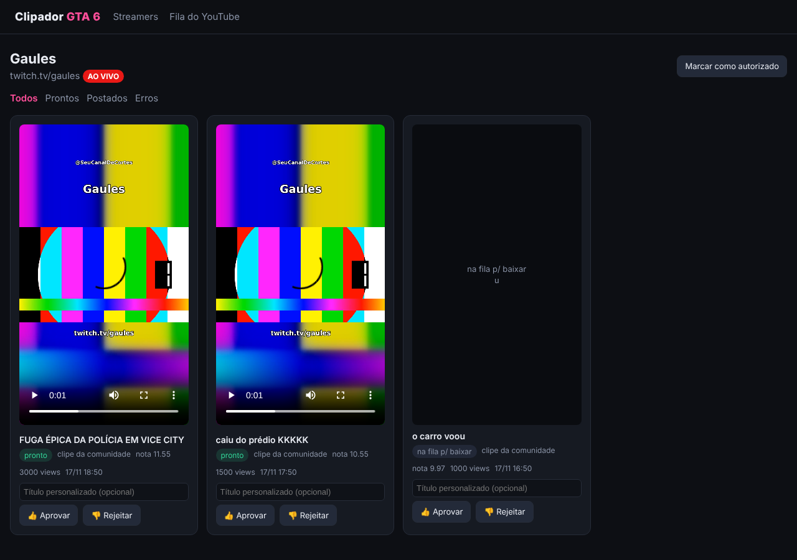

# Clipador GTA 6 🎬

Robô que acompanha as lives dos **30 maiores streamers brasileiros jogando GTA 6 na Twitch**,
encontra os melhores momentos, edita cada clipe no formato **YouTube Shorts (9:16)** com crédito ao
streamer e **posta no seu canal todo dia, de forma automática e agendada**. Um painel web mostra os
clipes **separados por streamer**, onde você aprova, rejeita ou troca o título.

**Modo tempo real (padrão):** cada clipe é publicado no YouTube assim que fica pronto, alguns
minutos depois do lance acontecer na live. O robô espalha a cota da API ao longo do dia para não
gastar tudo de manhã. **Identidade do canal pronta** (nome, descrição, banner, foto e marca
d'água) em [`branding/`](branding/README.md), junto com o passo a passo para criar o canal e
deixá-lo apto à monetização.

```
 Twitch API ──► descoberta (top 30 PT-BR em GTA VI, a cada 15 min)
                     │
 Chat IRC ────► detector de hype (chat explodiu? "KKKK", "CLIPA", KEKW...)  ──► momento
                     │                                                          │
 Twitch API ──► clipes da comunidade (os mais vistos do dia)    VOD da live ◄────┘ recorta 55s
                     │                                                │
                     └──────────────► yt-dlp + ffmpeg ◄───────────────┘
                                       (Shorts 1080x1920, fundo desfocado, nome + twitch.tv/canal)
                                             │
                          painel web (por streamer, aprovar/rejeitar/editar título)
                                             │
                     plano diário (1 clipe por streamer, rodízio justo, respeita a cota)
                                             │
                     YouTube Data API ──► upload agendado (publishAt) + compilação diária
```

## ⚠️ Leia antes do lançamento (3 coisas que podem travar tudo)

1. **A API do YouTube trava uploads como "privado" em projetos novos.** Todo projeto do Google
   Cloud criado depois de 28/07/2020 que não passou pela auditoria da API tem os vídeos enviados
   via API **bloqueados como privados**. Peça a auditoria **hoje** no formulário
   *"YouTube API Services – Audit and Quota Extension Form"* (o mesmo formulário pede aumento de cota).
   Enquanto não aprovam, use o modo **exportar** (abaixo): o robô gera a pasta do dia com os
   vídeos prontos + títulos/descrições/horários, e você agenda em lote no YouTube Studio.
2. **Cota da API:** o padrão é 10.000 unidades/dia e cada upload custa ~1.600 → **6 vídeos por dia**.
   O robô já respeita isso (posta os 6 melhores em rodízio entre streamers + 1 compilação com todos).
   Para 30/dia, peça aumento de cota no mesmo formulário e mude `daily_quota` no `config.yaml`.
3. **Direitos autorais / monetização.** O conteúdo das lives é dos streamers. Postar sem permissão
   pode gerar **strikes de direitos autorais (3 strikes = canal apagado)**, e o YouTube pode negar
   a monetização por **"conteúdo reutilizado"**. O que protege o canal:
   - Peça autorização. Muitos streamers BR têm programa oficial de "cortes" (alguns dividem receita).
     Marque `authorized: true` no `streamers.yaml` (ou o botão no painel) e, se quiser só postar
     quem autorizou, ligue `upload_only_authorized: true`.
   - Crédito sempre visível (o robô já põe nome + `twitch.tv/canal` no vídeo e link na descrição).
   - Agregue valor: títulos próprios, compilações, sua narração/edição — isso pesa na monetização.

## Instalação (Linux, Mac ou WSL)

Precisa de **Python 3.11+** e **ffmpeg**.

```bash
cd gta6-clips
python3 -m venv .venv && source .venv/bin/activate
pip install -r requirements.txt
cp config.example.yaml config.yaml
cp .env.example .env
```

### 1. Credenciais da Twitch (5 min)
1. Entre em <https://dev.twitch.tv/console/apps> → **Register Your Application**.
2. OAuth Redirect URL: `http://localhost` · Categoria: *Application Integration* · Client Type: *Confidential*.
3. Copie **Client ID** e gere um **Client Secret** → cole no `.env`.

### 2. Credenciais do YouTube (15 min)
1. <https://console.cloud.google.com/> → crie um projeto.
2. **APIs e serviços → Biblioteca** → ative **YouTube Data API v3**.
3. **Tela de consentimento OAuth**: tipo *Externo*, preencha nome/e-mail, adicione o escopo
   `youtube.upload`, e em **Status de publicação** clique em **"Publicar app" (Em produção)**.
   *Se deixar em "Teste", o token expira a cada 7 dias e o robô para de postar.*
4. **Credenciais → Criar credenciais → ID do cliente OAuth → App para computador (Desktop)**.
   Cole **Client ID** e **Client Secret** no `.env`.
5. Autorize o canal (abre o navegador; entre na conta do canal e aceite o aviso de "app não verificado"):
   ```bash
   python -m clipador youtube-auth           # no seu PC
   python -m clipador youtube-auth --manual  # num servidor sem navegador
   ```

### 3. Confira tudo
```bash
python -m clipador check
```

## Uso

| Comando | O que faz |
|---|---|
| `python -m clipador run` | **Roda tudo 24h**: descoberta, chat, coleta, edição, postagem diária + painel em <http://127.0.0.1:8080> |
| `python -m clipador discover` | Lista os streamers acompanhados e quem está ao vivo em GTA 6 |
| `python -m clipador harvest` | Coleta clipes, recorta momentos detectados e edita |
| `python -m clipador plan` | Mostra o que seria postado agora e em que horário |
| `python -m clipador post --dry-run` | Simula a rodada de postagem (sem enviar) |
| `python -m clipador post` | Faz a rodada de uploads agora |
| `python -m clipador export` | Gera `data/export/AAAA-MM-DD/` com vídeos + `postagens.txt` para postar à mão |
| `python -m clipador brand` | Aplica descrição, palavras-chave e banner do canal (`branding/canal.yaml`) |
| `python -m clipador canal` | Coleta agora os números do canal para o painel `/canal` |
| `python -m clipador web` | Só o painel |

### Painel do canal (`/canal`)
Abra <http://127.0.0.1:8080/canal> com o robô rodando. A cada 60 min (`dashboard.refresh_minutes`)
ele lê o canal no YouTube e mostra:
- **Perfil**: foto, banner, nome, @, descrição, inscritos (o número em destaque) e status da monetização.
- **Números do período** (7 / 28 / 90 dias / 12 meses), comparados com o período anterior:
  visualizações, horas assistidas, saldo de inscritos, receita estimada, RPM, duração média e curtidas.
- **Gráfico diário** interativo (passe o mouse ou use as setas do teclado) de views, horas,
  inscritos ou receita, com botão para ver a tabela.
- **Caminho para a monetização**: progresso até 1.000 inscritos + 4.000 h ou 10 mi de views em Shorts.
  Quando a monetização estiver ativa, mostra receita, RPM e CPM.
- **Desempenho por streamer**: quais streamers rendem mais views (cruza os cortes do robô com o YouTube).
- Origem do tráfego, países, público (idade e gênero), dispositivos, Shorts × vídeos longos.
- **Tabela de vídeos** com busca, filtro Shorts/longos e ordenação por coluna.
- **Status do robô**: quem está ao vivo, clipes prontos, publicados hoje e cota da API.

Os dados do YouTube Analytics chegam com ~48 h de atraso, como no YouTube Studio. Se algum
relatório falhar, o resto do painel continua e um aviso explica o motivo. **Depois de atualizar, rode
`python -m clipador youtube-auth` de novo**: o painel precisa de duas permissões novas (Analytics
e receita). `python -m clipador canal` faz uma coleta na hora e mostra o resumo no terminal.



### Rodando 24h num servidor (recomendado)
O robô precisa ficar ligado durante as lives (ele "ouve" o chat em tempo real). Uma VPS simples
(2 vCPU / 4 GB / 80 GB) dá conta. Com Docker:

```bash
docker compose up -d --build
docker compose logs -f
# painel: ssh -L 8080:127.0.0.1:8080 usuario@servidor  →  abra http://127.0.0.1:8080
```
O Docker reinicia o robô sozinho se ele cair, e verifica a saúde dele a cada minuto em
`/api/saude`. Dentro do robô, cada tarefa (chat, coleta, postagem, painel) também é reiniciada
sozinha se der erro, sem derrubar as outras. Sem Docker, use o `clipador.service` (systemd). Defina `DASHBOARD_PASSWORD` no `.env` se for
expor o painel.

### Rotina do dia do lançamento
1. Deixe `python -m clipador run` ligado desde antes do lançamento.
2. **Modo tempo real** (`youtube.mode: realtime`): com streamers ao vivo, o robô procura clipes
   novos a cada 5 min, edita e publica o melhor clipe recente na hora. Ele respeita a cota, o
   intervalo entre uploads e o limite de 1 vídeo por streamer por dia (`youtube.realtime`).
   A compilação diária sai no horário de `daily_run_time`.
3. Ao longo do dia, abra o painel e rejeite clipes ruins antes que subam. Se quiser aprovar tudo
   à mão, use `auto_approve: false`. O botão "⚡ Postar 1 agora" força uma publicação.
4. Prefere agendar em horários fixos? Use `youtube.mode: daily`: às 08:30 e 15:30 o robô sobe
   os vídeos **agendados** nos horários de `publish_slots`.
5. Enquanto a API estiver travada (aviso 1 lá em cima), rode `python -m clipador export` e
   poste os vídeos da pasta pelo YouTube Studio.

## Configuração (`config.yaml`)
Os campos principais (todos comentados em `config.example.yaml`):

- `twitch.max_streamers` (30), `twitch.min_viewers`: tamanho da lista e corte de audiência.
- `streamers.yaml`: canais fixos. **Confira os logins** — o `check` avisa quais não existem. O resto
  da lista é completado automaticamente com as maiores lives PT-BR na categoria GTA VI.
- `hype.z_threshold`: sensibilidade do detector (menor = mais clipes, mais ruído).
- `hype.pre_roll_seconds`: quanto pegar **antes** da explosão do chat (o chat reage com atraso).
- `youtube.mode`: `realtime` (publica assim que acontece) ou `daily` (agenda em horários fixos).
- `youtube.realtime`: janela do dia em que pode postar, idade máxima do clipe, vídeos por streamer/dia.
- `youtube.publish_slots`, `youtube.daily_run_time`: horários do modo daily e da compilação.
- `youtube.auto_approve`: `false` = só posta o que você aprovar no painel.
- `render.watermark`: o @ do seu canal no vídeo.

## Como funciona por dentro

**Detector de hype** (`clipador/hype.py`): para cada canal, conta as mensagens dos últimos 10 s
(com peso extra para "kkkk", KEKW e principalmente "CLIPA"). Mantém uma média móvel exponencial do
"ritmo normal" do chat e calcula o *z-score* `(atual − média) / desvio`. Se passar de 3,5 e tiver
volume mínimo, abre um "momento", acompanha até o pico e fecha quando o chat acalma. Como compara
cada canal com ele mesmo, funciona tanto para um chat de 50 mil pessoas quanto para um de 2 mil.

**Recorte**: o horário do momento menos o início da live = posição no VOD. O `yt-dlp` baixa só
aquele trecho (40 s antes + 15 s depois). Momentos que coincidem com um clipe da comunidade são
descartados para não postar o mesmo lance duas vezes.

**Postagem**: no máximo 1 vídeo por streamer por dia; quem teve menos vídeos postados até agora
vai primeiro (rodízio), depois o clipe de maior nota. A cota é contada pelo dia do Pacífico (é
quando o Google zera). Vídeos sobem como privados com `publishAt` e o YouTube publica na hora certa.

## Testes
```bash
pip install -r requirements-dev.txt
python -m pytest
```
Os testes simulam Twitch e YouTube, mas rodam o ffmpeg de verdade (gera Shorts 1080x1920).

## Estrutura
```
clipador/
  twitch.py      API Helix (lives, clipes, VODs)
  discovery.py   top 30 streamers BR em GTA VI
  chat.py        leitor anônimo do chat (IRC)
  hype.py        detector de momentos (lógica pura)
  harvest.py     junta clipes da comunidade + momentos do chat
  media.py       yt-dlp + ffmpeg (Shorts, horizontal, compilação)
  metadata.py    títulos, descrições e tags em PT-BR
  planner.py     rodízio, cota e horários
  youtube.py     OAuth + upload resumível + agendamento
  publisher.py   rodada diária e exportação manual
  web.py         painel (FastAPI) + templates/
  app.py         orquestrador 24h
branding/        identidade do canal (banner, avatar, marca d'água, descrição) + guia
```

## Capturas do painel (dados de demonstração)


